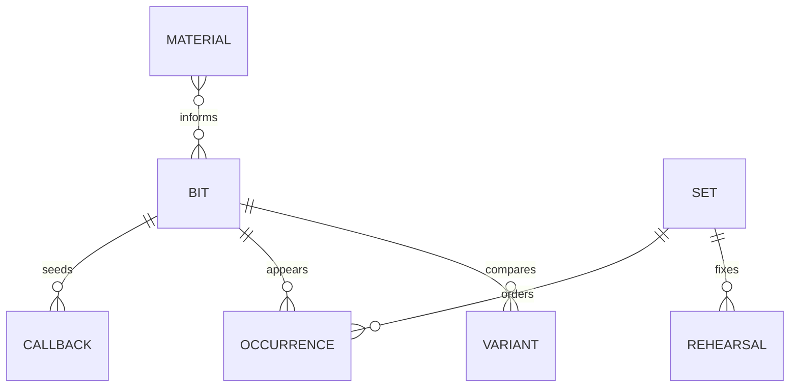

# 领域与本体设计

## 专业聚合

Material原始素材、Bit段子、Callback回扣、Set节目段单、Occurrence独立出场、Variant包袱备选、Rehearsal开放麦手记、Note意见。根字段：materials、bits、callbacks、sets、variants、rehearsals、notes、basis_refs。专业对象以WorkRef＋owner_plugin_id＋object_id确定身份，revision＋sha256固定内容。相同标题不代表同一对象。

素材固定来源并只追加；铺垫、包袱、追加包袱分别保留。回扣固定两端段子组合摘要，段单按独立出场核验铺垫先于回扣，重复段子不去重。改稿后旧回扣、段单、备选及意见明确待复核；局部备选使用完整段子摘要，其他段子原字节保持。开放麦记录保存固定段单快照与提交者手记，不把估时或模拟当真人观众反馈，不按笑声次数评判作品品质。

所有集合ID唯一、所有引用存在、集合有界、顺序在对应父级唯一。撤销先处理依赖，不能制造悬空引用；来源索引只追加，整本保存不能改变原索引意义。跨包引用只携带固定Owner、对象、修订与摘要，通过公开SDK回读，不导入对方私有结构。

## 权属

原始资料、作品身份与受管事务归Core；专业记录归本包；理解、创作与解释归作者选择的外部Agent；表达取舍与定稿归作者。借助欧卡姆原理复用通用事实，只增加本旅程需要的专业状态。
