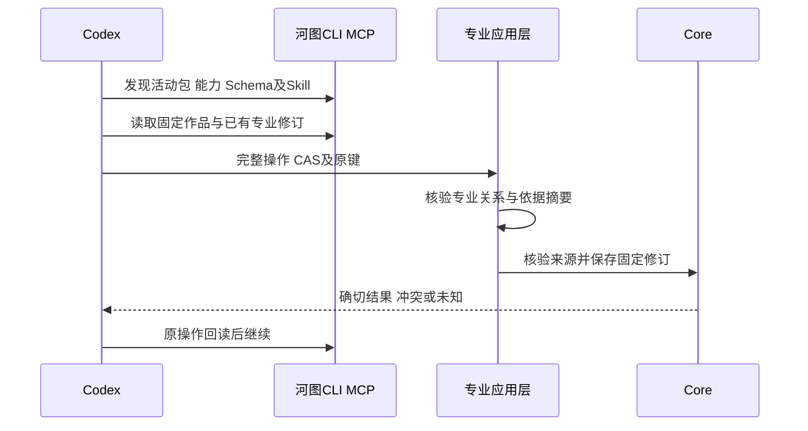

# 数据与API设计

## 格式

manifest_version=1、Host API=1、format_version=1、专业schema_version=1.0.0。正式字段以contracts/plugin-manifest.json为Owner，完整保存及集合动作从同一数据Schema派生；Ajv在构建时生成静态校验器，运行时不eval。专业字段为materials、bits、callbacks、sets、variants、rehearsals、notes、basis_refs。

无独立SQL库、Migration或本机原稿目录。专业聚合保存为Core固定JSON修订；每工程上限512KiB、100来源，各集合及字符串上限由可执行Schema定义。公开SDK负责CAS、来源校验、历史与原操作。

## 调用合同

稳定CLI/MCP通过plugins.inspect、plugins.capabilities、plugins.invoke及skills.read发现并操作。请求携带精确WorkRef、management_ref、活动包和能力摘要。新建expected_revision=0与空摘要，更新要求确切revision和sha256；每个写请求使用原operation_key。

通用list_projects、get_project、save_project、get_source、get_basis、compare_versions、build_context、create_handoff、export_project和get_operation共用同一应用层。专业动作及参数由CAPABILITIES和包内operations生成，不复制进宿主清单。

## 导出与错误

get_source按UTF-8边界分块；错误字节、摘要或引文拒绝。专业文件返回base64、offset、next_offset、total_bytes、sha256和chunk_sha256。重组全部字节后核对完整摘要；桌面save_artifact走作者选目标、取消和原子落盘的公开服务。

same-key/same-input返回原结果，same-key/different-input拒绝。未知先get_operation，不换键重复写；冲突保留输入，明确读取新基线并核对差异。停用不清理旧成果，安装生命周期不构成正文采纳。固定旧修订不可覆盖；未来格式改变先形成显式迁移方案。

## 专业执行边界

回扣固定两端段子摘要；段单按独立出场检查先后，包袱备选固定整个段子。手记仅是提交者声明，不推断观众数量或笑点质量。
